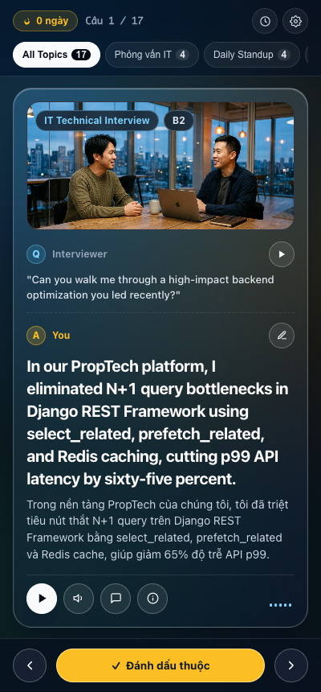

# 🎙️ IT English Daily Split-View Extension (19:00 Reminder)

Tiện ích Chrome (Manifest V3) giúp lập trình viên luyện **Tiếng Anh Phỏng vấn IT & Giao tiếp công việc** mỗi ngày lúc **19:00**, tự động mở khung học bên cạnh cửa sổ làm việc (**Split-View 70/30** hoặc **Chrome Side Panel**) mà không làm gián đoạn công việc.

[](https://github.com/Hungmaix94/it-english-split-extension/releases/latest/download/it-english-split-extension-v1.0.0.zip)

---

## 🎬 Video hướng dẫn sử dụng & Demo thực tế

> 📺 **Xem trực tiếp Video Hướng Dẫn Sử Dụng (Cloudflare R2 CDN - MP4):**
> - **[👉 Bấm vào đây để phát trực tiếp Video Hướng Dẫn (demo-it-english-split-view.mp4)](https://pub-dd118e9f58254711a5ec2f75e6bf0530.r2.dev/test-videos/demo-it-english-split-view.mp4)**
> - URL trực tiếp: `https://pub-dd118e9f58254711a5ec2f75e6bf0530.r2.dev/test-videos/demo-it-english-split-view.mp4`

<p align="center">
  <a href="https://pub-dd118e9f58254711a5ec2f75e6bf0530.r2.dev/test-videos/demo-it-english-split-view.mp4">
    
  </a>
</p>

### Các thao tác chính trong video hướng dẫn:
1. **Đọc hội thoại phỏng vấn IT theo ngữ cảnh**:
   - Quan sát tranh minh họa trực quan trên đầu thẻ.
   - Đọc câu hỏi của **INTERVIEWER (`Q`)** và câu trả lời mẫu của **YOU (`A`)** kèm nghĩa tiếng Việt bên dưới.
2. **Cá nhân hóa câu trả lời theo vị trí của bạn (`✏️`)**:
   - Bấm trực tiếp vào câu trả lời tiếng Anh hoặc nút tròn **`✏️`**.
   - Chọn nhanh mẫu câu theo vị trí (**Backend / API**, **Frontend / UI**, **System / Cloud**) hoặc tự gõ câu trả lời theo dự án thực tế của bạn rồi bấm **Lưu câu trả lời**.
3. **Luyện nghe & nhại lại (Shadowing)**:
   - **`▶`**: Nghe đọc câu trả lời tốc độ chuẩn (`1.0x`) — tự động đọc theo câu bạn đã cá nhân hóa.
   - **`🔊`**: Nghe đọc chậm (`0.75x`) để bắt rõ từng âm tiết.
   - **`💬`**: Nghe toàn bộ đoạn hội thoại Hỏi – Đáp (`Interviewer` -> `You`).
4. **Xem phiên âm & từ khóa (`ℹ️`) / Cài đặt lịch nhắc (`⚙️`)**:
   - Bấm **`ℹ️`** để mở ngăn xem phiên âm IPA, cụm từ ăn điểm (*Key Chunks*) và cách diễn đạt tương đương.
   - Bấm **`⚙️`** trên góc phải để đổi giờ nhắc hằng ngày (mặc định `19:00`) hoặc chế độ mở (**Side Panel** / **Chia màn hình 70/30**).
   - Bấm **`⏰`** để hoãn nhắc 15 phút (*Snooze*) khi đang bận họp/code.
5. **Đánh dấu thuộc & chuyển câu**:
   - Bấm **`✓ Đánh dấu thuộc`** ở thanh dưới cùng để lưu tiến độ, hoặc bấm **`←`** / **`→`** để chuyển câu.

---

## 🚀 Hướng dẫn cài đặt vào Google Chrome / Brave / Edge

### Cách 1: Cài nhanh từ file `.zip` (Khuyên dùng cho người dùng)
1. Tải file **[`it-english-split-extension-v1.0.0.zip`](https://github.com/Hungmaix94/it-english-split-extension/releases/latest/download/it-english-split-extension-v1.0.0.zip)** tại mục **Releases** và giải nén ra một thư mục trên máy.
2. Mở trình duyệt Chrome, truy cập địa chỉ: `chrome://extensions/`
3. Bật công tắc **Developer mode** (*Chế độ dành cho nhà phát triển*) ở góc trên bên phải.
4. Bấm nút **Load unpacked** (*Tải tiện ích đã giải nén*) ở góc trên bên trái và chọn thư mục vừa giải nén.
5. Bấm vào biểu tượng tiện ích trên thanh công cụ Chrome để mở ngay khung luyện tập!

### Cách 2: Cài từ mã nguồn (Dành cho Developer)
```bash
git clone https://github.com/Hungmaix94/it-english-split-extension.git
cd it-english-split-extension
npm test
```
Sau đó mở `chrome://extensions/` -> bật **Developer mode** -> chọn **Load unpacked** -> trỏ tới thư mục `it-english-split-extension`.

---

## 📁 Cấu trúc thư mục

```text
it-english-split-extension/
├── manifest.json                 # Cấu hình Chrome Extension Manifest V3
├── assets/
│   ├── interview-scene.jpg       # Tranh minh họa cảnh phỏng vấn IT
│   └── ui-preview.png            # Ảnh chụp giao diện thực tế
├── background/
│   └── service-worker.js         # Hẹn giờ 19:00, thông báo, tự chia màn hình 70/30 & Side Panel
├── data/
│   └── sentences.js              # Ngân hàng câu hội thoại Phỏng vấn IT & Giao tiếp công việc
├── sidepanel/
│   ├── sidepanel.html            # Giao diện Glassmorphism tối giản 1 thẻ hội thoại
│   ├── sidepanel.css             # Thiết kế Dark Glassmorphism + nút tròn Icon-only
│   └── sidepanel.js              # Logic cá nhân hóa câu trả lời, Web Speech TTS & lưu tiến độ
├── demo-it-english-split-view.mp4 # Video hướng dẫn sử dụng thực tế
└── tests/                        # Bộ 50 unit & integration tests (Node test runner)
```
